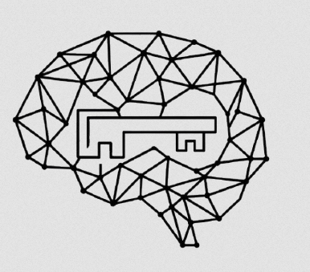
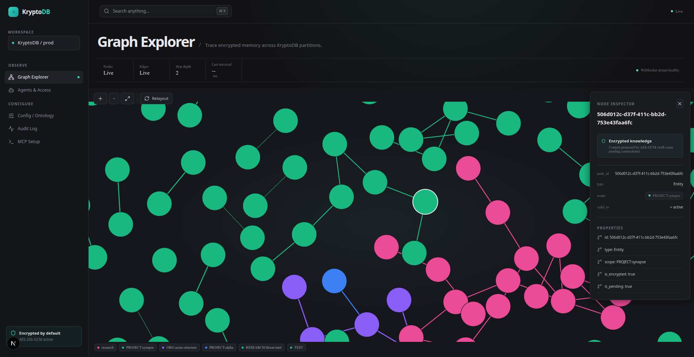

<div align="center">
  
  <h1>KryptoDB</h1>
  <p><b>K</b>nowledge <b>R</b>etrieval & <b>Y</b>ielding <b>P</b>rotocol for <b>T</b>rustless <b>O</b>perations <b>D</b>ata<b>B</b>ase</p>
  <p><i>Crypto-Enforced, Multi-Agent Memory Access Control on Neo4j</i></p>
  
  
  
  
  </p>
</div>

KryptoDB is an advanced, graph-based memory server designed specifically for multi-agent environments. Every knowledge item is encrypted with its own AES-256-GCM data-encryption key. API-key identity, scope authorization  , and session activation determine whether an item can be searched by an agent.

It exposes its memory substrate via the **Model Context Protocol (MCP)**, allowing AI agents to read, write, and manage knowledge securely.

---

<div align="center">
  
  <label>KryptoDB Playground</label>
</div>

---

## ❖ Key Features

### 1. Per-Knowledge Envelope Encryption
- **Unique DEK:** Every new fact gets a fresh random AES-256-GCM data-encryption key in protected mode.
- **Wrapped DEK:** A stable scope key wraps only the per-knowledge DEK; agents never receive DEKs or KEKs.
- **Complete envelope:** Subject, predicate, object, description, source identity, tags, and sensitive fact metadata are encrypted before persistence.
- **Authenticated data:** The envelope is bound to its knowledge ID, scope, and schema version.

### 2. API-Key and Session Access Control
- **Identity-bound API keys:** Bearer API keys resolve the agent identity server-side; client-supplied `AGENT_ID` is not an authorization source.
- **Scope intersection:** Effective scopes are the intersection of the agent configuration and the individual API key's scope limit.
- **Session activation gate:** A partition key must be active in the authenticated session before search tokens or plaintext can be produced.
- **Revocation:** API-key revocation and agent-scope changes immediately invalidate associated sessions and decrypted search state.
- **Admin boundary:** Key management, onboarding, agent configuration, and ontology access require an admin API key.

### 3. Searchable Encryption
- **HMAC indexes:** Subject, predicate, object, and token indexes are keyed HMAC values, not plaintext fields.
- **Search-before-decrypt:** Neo4j returns candidates by encrypted indexes; the daemon decrypts only authorized final candidates.
- **Body-based MCP queries:** MCP search uses `POST /memory/{agent_id}/query`, avoiding plaintext terms in URLs.
- **Supported search:** Exact and token search are supported. Confidential substring, fuzzy, ranked, and semantic search are intentionally out of scope.
- **Known leakage:** Equality/frequency, graph topology, and access patterns may remain observable.

### 4. Background Revocation Cascades
When a primary fact is superseded by a newer, more trustworthy fact, KryptoDB initiates a recursive revocation cascade along `derived_from` edges. 
- Deep cascades are offloaded to asynchronous FastAPI `BackgroundTasks`.
- Status endpoints (`/status/{task_id}`) allow agents to asynchronously poll the completion state, protecting the database from write-amplification deadlock storms.

### 5. Ephemeral Global Clustering
For global summarization (e.g., "what are the main themes of this project?"), we dynamically project a temporary graph in Neo4j RAM, run the Louvain community detection algorithm via GDS, cache the insights, and instantly destroy the projection to protect memory constraints.

### 6. Controlled Onboarding and Migration
- Onboarding is admin-only; ordinary agents cannot grant themselves scopes.
- `migrate_legacy_tool` converts old partition-encrypted facts into per-knowledge envelopes for active authorized scopes.
- Knowledge-level reclassification regenerates the envelope and search indexes under the target scope.

---

## ⬡ System Architecture


---

## ❯ Getting Started

### Prerequisites
- Python 3.10+
- Neo4j 5.x (with APOC and Graph Data Science plugins enabled)
- Redis 7.x
- SQLite (built-in)

### Installation
1. Clone the repository and install dependencies:
```bash
python -m venv .venv
source .venv/bin/activate
pip install -e .
```
2. Configure your environment variables in `.env`:
```env
NEO4J_URI=bolt://localhost:7687
NEO4J_USER=neo4j
NEO4J_PASSWORD=password
# Use 6380 when Redis is provided by the repository's local docker-compose.yml;
# use 6379 for a native Redis installation.
REDIS_URL=redis://localhost:6380/0
KRYPTODB_ENV=development
KRYPTODB_MASTER_KEY=<64-hex-character-key>
KRYPTODB_ADMIN_API_KEY=<admin-key>
# Optional customer-managed scope keys
KRYPTODB_SCOPE_KEYS_JSON={"diagnosis":{"key_id":"diagnosis:v1","key":"<base64-32-byte-key>"},"patients":{"key_id":"patients:v1","key":"<base64-32-byte-key>"}}
# Or: KRYPTODB_SCOPE_KEYS_FILE=/run/secrets/kryptodb-scope-keys.json
# Temporary first-run staging mode; use only when intentionally bootstrapping
# an empty deployment without scope keys.
KRYPTODB_BOOTSTRAP_UNENCRYPTED=false
```

### Running the Server
Launch the backend Daemon (which handles cryptographic state, connections, and background workers):
```bash
uvicorn kryptodb.daemon.server:app --host 127.0.0.1 --port 8000
```

Run the MCP interface for an agent. It must receive an agent API key, not the
administrator key or a customer encryption key:
```bash
AGENT_ID=Agent-1 KRYPTODB_API_KEY=<agent-api-key> \
  python -m kryptodb.daemon.mcp_server
```

## 🔌 Connecting the MCP Server

KryptoDB implements the Model Context Protocol (MCP) to seamlessly provide zero-trust memory to modern AI tools.

### Claude Desktop Integration

1. Start the production stack. It includes the KryptoDB web/MCP image,
   Neo4j, and Redis:
```bash
docker compose -f kryptodb-compose.yml up -d
```
2. Open your Claude Desktop configuration file:
   - **Mac**: `~/Library/Application Support/Claude/claude_desktop_config.json`
   - **Windows**: `%APPDATA%\Claude\claude_desktop_config.json`
3. Add a configuration that launches the published image in MCP mode. Keep the
   agent credential in a protected secret file; do not put it in the JSON or a
   command-line argument:
```json
{
  "mcpServers": {
    "kryptodb": {
      "command": "/home/harshit-kandpal/Documents/github_files/AIAgent/.venv/bin/python",
      "args": [
        "-m", 
        "kryptodb.daemon.mcp_server"
      ],
      "env": {
        "AGENT_ID": "Agent-1",
        "KRYPTODB_API_KEY": "<paste-api-key>",
        "KRYPTODB_URL": "http://127.0.0.1:8000"
      }
    }
  }
}
```

4. Restart Claude Desktop. Activate a permitted scope with
   `session_activate_tool` before querying.

### Codex / TOML Configuration

If you are running Codex (or RooCode/Windsurf) on the same machine as your backend, you can run the MCP server natively via Python without dealing with Docker networks. 

Add the following to your Codex configuration file (make sure to replace the `<paste-api-key>` placeholder):

```toml
[mcp_servers.kryptodb]
command = "/home/harshit-kandpal/Documents/github_files/AIAgent/.venv/bin/python"
args = ["-m", "kryptodb.daemon.mcp_server"]

[mcp_servers.kryptodb.env]
AGENT_ID = "Agent-1"
KRYPTODB_API_KEY = "<paste-api-key>"
KRYPTODB_URL = "http://127.0.0.1:8000"
```

### Cursor IDE Integration

1. Start the production stack with `docker compose -f kryptodb-compose.yml up -d`.
2. Open Cursor Settings → Features → MCP Servers.
3. Click **+ Add New MCP Server**.
4. Name it `KryptoDB`.
5. Set the Type to `command`.
6. Set the command to the equivalent Docker invocation from the Claude example,
   using your protected agent-key file and `--network kryptodb_default`.
7. Save and refresh. Activate a permitted partition with `session_activate_tool` before querying.

---

## ⚙ MCP Tools Exposed

KryptoDB exposes the following tools to the LLM agent via the Model Context Protocol:

| Tool Name | Description |
|-----------|-------------|
| `propose_fact_tool` | Propose a new encrypted fact, optionally including a description. |
| `query_memory_tool` | Search authorized knowledge using subject or encrypted exact/token indexes. |
| `session_activate_tool` | Activate permitted partition keys for the current MCP session. |
| `session_show_tool` | Inspect currently active partitions for the current session. |
| `migrate_legacy_tool` | Convert authorized legacy facts into per-knowledge envelopes. |
| `reclassify_tool` | Re-encrypt a knowledge item under a different active scope. |
| `run_onboard_tool` | Admin-only schema onboarding from sample facts. |
| `task_status_tool` | Poll the status of background graph mutations (cascades). |

### API-Key Setup

#### Development (local only)

> **⚠️ Development only.** The following uses plaintext HTTP, reads the admin
> key from an environment variable, and prints the returned secret to the
> terminal. Do not use this in production.

```bash
curl -X POST http://127.0.0.1:8000/admin/api-keys \
  -H "Authorization: Bearer $KRYPTODB_ADMIN_API_KEY" \
  -H "Content-Type: application/json" \
  -d '{"agent_id":"Agent-1","scopes":["research"]}'
```

This is only for localhost testing. It prints the one-time agent credential and
must not be used on a shared or remotely reachable deployment.

#### Production bootstrap

In production, use the built-in bootstrap command instead of `curl`. When using
the published image, run the CLI from the image with the admin secret mounted:

```bash
docker run --rm \
  --network kryptodb_default \
  --user "$(id -u):$(id -g)" \
  --mount type=bind,source=/secure/kryptodb/admin-key,target=/run/secrets/admin-key,readonly \
  --mount type=bind,source=/secure/kryptodb/agent-1-api-key,target=/run/secrets/agent-key \
  --entrypoint python \
  ghcr.io/prolomaster/kryptodb:latest \
  -m kryptodb.cli bootstrap \
  --agent-id Agent-1 \
  --scopes research \
  --admin-key-file /run/secrets/admin-key \
  --out-file /run/secrets/agent-key \
  --url http://kryptodb:8000
```

Before running it, create the protected input and output files on the host, for
example with `install -m 600 /dev/null /secure/kryptodb/agent-1-api-key`.
The admin-key file must already contain the administrator credential. The
command writes the new agent key with mode `0600` and does not print the raw
key. Adjust the mounted paths to match your host paths exactly.

Additional production requirements:
- Bind the daemon to localhost and expose it through an **HTTPS reverse proxy** or private network.
- Mount `KRYPTODB_ADMIN_API_KEY` as a Docker/Kubernetes secret file, not a plain env var (see `kryptodb-compose.yml`).
- In normal/locked mode, API key creation is **rejected** if the requested scope's customer encryption key is not configured. Explicit bootstrap mode may provision scoped agents for pending writes.
- Restrict or disable the `/admin/api-keys` route after initial provisioning where practical.

The daemon returns the raw API key only once; the CLI writes it to the output
file without printing it. API keys are authentication credentials, not
encryption keys.

### Bootstrap and Legacy Migration

For an intentionally unencrypted first-run staging deployment, set:

```env
KRYPTODB_BOOTSTRAP_UNENCRYPTED=true
```

New records are marked `pending` and the UI displays an unencrypted warning.
Configure the required scope keys, restart the server, run migration preflight,
then use **Migrate and lock encryption**. Do not use this mode for sensitive data
until migration has completed.

Activate the relevant legacy scopes first, then call `migrate_legacy_tool`. Migration decrypts and re-encrypts records inside the daemon, removes legacy relationship fields only after successful conversion, and returns counts rather than plaintext.

### Dataset Encryption Boundaries

When importing a new knowledge base, choose one of two modes:

- **New isolated scope/key:** configure a new customer scope key, such as `research:v1`, and import the dataset under that scope.
- **Existing scope/key:** attach the dataset to an existing scope, such as `diagnosis`. New items automatically use that scope's customer KEK and derived search key, while still receiving unique per-item DEKs.

The scope must be explicit. In normal mode, if its customer key is unavailable,
writes and session activation fail closed. In explicit bootstrap mode, new records
are marked `pending` and must be migrated before bootstrap is locked. The frontend
shows scope-key IDs, fingerprints, and availability; it only generates or
validates a one-time secret file during administrator bootstrap.

## Frontend

The Next.js frontend is an authenticated operational console for graph inspection,
agent access, ontology, audit, and MCP setup.

For direct development:

```bash
cd ui
npm install
NEXT_PUBLIC_KRYPTODB_URL=http://127.0.0.1:8000 npm run dev
```

Open `http://localhost:3000`. For the unified Docker image, open
`http://localhost:8000`; the frontend is served by the daemon from the same
origin. The UI requires the administrator API key for administration. It never
receives customer encryption keys and does not display plaintext until the
backend has authorized and decrypted a knowledge envelope.

---

## ✦ Contributors

Made with ❤️ by **Harshit Kandpal** - *Creator & Lead Developer*

Contributions, issues, and feature requests are welcome! Feel free to check the issues page or consult standard open-source contribution guides to get started.

---
*  If you found this helpful, consider giving it a star on GitHub!*
