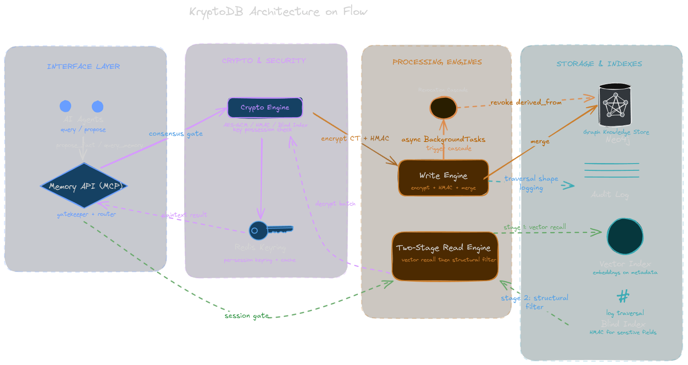

<div align="center">
  
  <h1>KryptoDB</h1>
  <p><i>Multi-Agent Memory Access Control on Neo4j</i></p>
  
  
  
</div>

KryptoDB is a graph-based memory server for multi-agent systems, exposing its knowledge substrate via the Model Context Protocol (MCP). It enforces strict access boundaries using per-knowledge AES-256-GCM envelope encryption, API-key identity, and session activation gates.

---

<div align="center">
  
</div>

---

## 🔒 Security Model & Residual Trust

KryptoDB isolates knowledge between agents using envelope encryption. Every new fact receives a fresh random Data Encryption Key (DEK), wrapped by a stable Key Encryption Key (KEK) tied to a specific permission scope. Agents never receive DEKs or KEKs; the daemon decrypts only authorized final candidates.

### Residual Trust
The system is designed to isolate agents from one another, but heavily relies on trusted infrastructure components:
- **Daemon Process:** The central FastAPI process performs decryption and handles all key material in plaintext. It must run in a trusted, hardened environment.
- **Master & Scope Keys:** KEKs are held in memory by the daemon. The host filesystem must aggressively protect `.env` and `synapse-scope-keys.json`.
- **Backend Storage:** Redis and Neo4j hold ciphertexts and perform pre-filtering. Standard network isolation and database ACLs are still required to prevent tampering.

---

## ⬡ Architecture Overview

KryptoDB operates as an intermediary broker between LLM agents and the encrypted graph:
1. **Agent** sends an MCP tool call (e.g. `query_memory_tool`) to the local MCP client.
2. **MCP Client** forwards the request to the central **Daemon** via HTTPS with a bearer API key.
3. **Daemon** computes HMAC indexes for the query terms and executes a **Search-before-decrypt** cypher query against **Neo4j**, utilizing deterministic HMAC-based searchable encryption algorithms to perform exact-match and token-based lookups directly on ciphertext indexes without revealing the search query to the database.
4. **Neo4j** returns candidate ciphertexts matching the cryptographic hashes.
5. **Daemon** drops unauthorized candidates, decrypts the remainder using the active session scope key, and returns plaintext to the Agent.



*Note: Ephemeral clustering (Louvain community detection) can be invoked by setting `mode='global'` on queries, which temporarily projects the graph into Neo4j RAM and instantly destroys it after summarization to protect memory limits.*

---

## 🚀 Quick Start (Local Development)

> **⚠️ WARNING:** The following instructions are for local development only. They use plaintext HTTP, print secrets to the terminal, and utilize an unencrypted bootstrap mode. Do not use this setup for production data.

### Prerequisites
- Python 3.10+
- Neo4j 5.x (with APOC and GDS plugins)
- Redis 7.x
- *(SQLite is bundled internally by the daemon for lightweight state tracking, no setup required).*

### 1. Start the backend
Ensure Docker is installed, then launch the production stack (which includes KryptoDB, Neo4j, and Redis) in detached mode:

```bash
docker compose -f kryptodb-compose.yml up -d
```
*The web UI is now accessible at http://127.0.0.1:8000.*

### 2. Provision an Agent API Key
In a separate terminal, use the admin key to mint an agent credential:
```bash
curl -X POST http://127.0.0.1:8000/admin/api-keys \
  -H "Authorization: Bearer dev-admin-key" \
  -H "Content-Type: application/json" \
  -d '{"agent_id":"Agent-1","scopes":["research"]}'
```
*Note the returned `api_key`.*

### 3. Connect via MCP (Claude Desktop / Cursor / Codex)
Add the Docker MCP server to your IDE/client configuration, replacing `<paste-api-key>` with the key from the previous step:

**JSON Format (Claude / Cursor):**
```json
{
  "mcpServers": {
    "kryptodb": {
      "command": "docker",
      "args": [
        "run",
        "-i",
        "--rm",
        "--network", "aiagent_default",
        "-e", "AGENT_ID=Agent-1",
        "-e", "KRYPTODB_API_KEY=<paste-api-key>",
        "-e", "KRYPTODB_URL=http://daemon:8000",
        "ghcr.io/prolomaster/kryptodb:latest",
        "mcp"
      ]
    }
  }
}
```

**TOML Format (RooCode / Windsurf / Codex):**
```toml
[mcp_servers.kryptodb]
command = "docker"
args = [
  "run",
  "-i",
  "--rm",
  "--network", "aiagent_default",
  "-e", "AGENT_ID=Agent-1",
  "-e", "KRYPTODB_API_KEY=<paste-api-key>",
  "-e", "KRYPTODB_URL=http://daemon:8000",
  "ghcr.io/prolomaster/kryptodb:latest",
  "mcp"
]
```

---

## 🛠 MCP Tools Reference

The primary interface for agents is the MCP tool suite.

| Tool Name | Purpose | Example Payload |
|-----------|---------|-----------------|
| `session_activate_tool` | Unlocks partition keys for the current session. **Must be called before querying.** | `{"active_partitions": ["research"]}` |
| `propose_fact_tool` | Write a new encrypted fact to a specific scope. | `{"subject": "Project X", "predicate": "relies_on", "obj": "DB1", "scope": "research"}` |
| `query_memory_tool` | Search authorized knowledge. Set `mode='global'` for Louvain clustering. | `{"subject_id": "Project X"}` |
| `session_show_tool` | Inspect currently active partitions for the session. | `{}` |
| `task_status_tool` | Poll the status of background graph mutations (revocation cascades). | `{"task_id": "uuid-here"}` |
| `migrate_legacy_tool` | Convert authorized legacy facts into per-knowledge envelopes. | `{"scopes": ["research"]}` |
| `reclassify_tool` | Re-encrypt a knowledge item under a different active scope. | `{"node_id": "uuid-here", "to_scope": "operations"}` |

---

## 🛡 Production Deployment

When transitioning from local development to a production environment, strictly enforce the following rules:

1. **Disable Bootstrap Mode:** Set `KRYPTODB_BOOTSTRAP_UNENCRYPTED=false`. If left true, new records will be staged unencrypted, bypassing the primary security model.
2. **Reverse Proxy:** Bind the daemon strictly to `localhost` and expose it via an HTTPS reverse proxy. Never expose plaintext HTTP.
3. **Secret Mounting:** Mount `KRYPTODB_ADMIN_API_KEY` and scope keys as Docker/Kubernetes secrets (e.g. using `KRYPTODB_SCOPE_KEYS_FILE`). Do not pass them as plaintext environment variables.
4. **Agent CLI Bootstrap:** Use the KryptoDB CLI to provision agent keys securely via volume mounts, rather than `curl`.

**Example Production Agent Bootstrap:**
```bash
docker run --rm \
  --network your_backend_net \
  --user "$(id -u):$(id -g)" \
  --mount type=bind,source=/secure/kryptodb/admin-key,target=/run/secrets/admin-key,readonly \
  --mount type=bind,source=/secure/kryptodb/agent-1-api-key,target=/run/secrets/agent-key \
  --entrypoint python \
  ghcr.io/prolomaster/kryptodb:latest \
  -m kryptodb.cli bootstrap \
  --agent-id Agent-1 \
  --scopes research \
  --admin-key-file /run/secrets/admin-key \
  --out-file /run/secrets/agent-key \
  --url http://kryptodb:8000
```
*(Ensure input and output files are pre-created with `0600` permissions on the host. The CLI writes the new agent key to the output file without printing it to stdout.)*

---
## License
Released under the MIT License.

---
## Contributors
Made with ❤️ by **Harshit Kandpal** - *Creator & Lead Developer*
