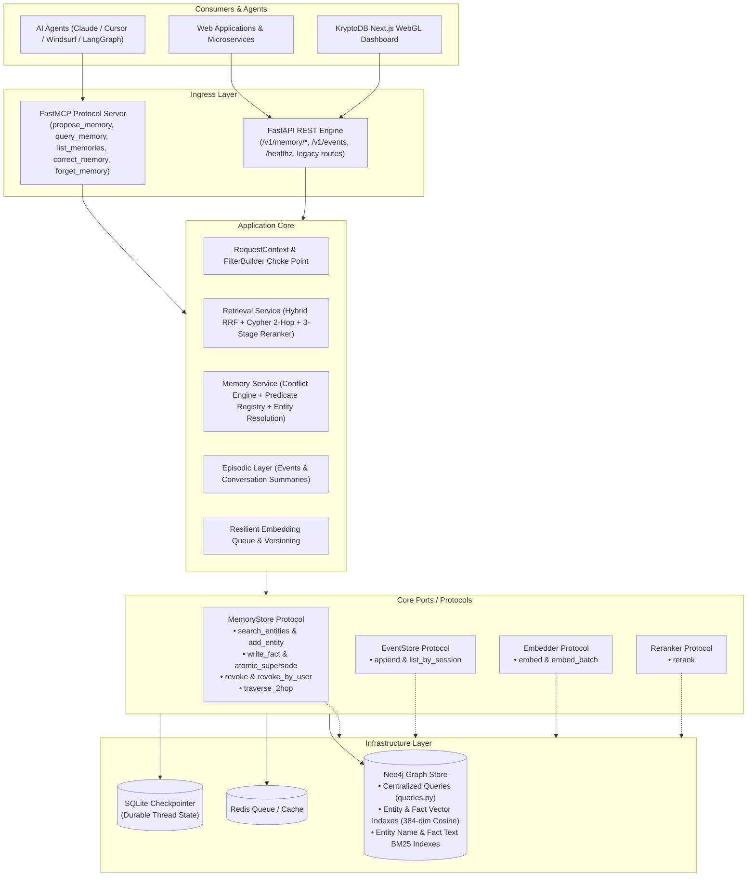

<div align="center">
  
  <h1>KryptoDB</h1>
  <p><i>High-Performance Multi-Agent GraphRAG & Memory Infrastructure on Neo4j</i></p>
  <p>
    
    
    
    
    
    
    
    
    
    
  </p>
</div>

---

**KryptoDB** is a production-grade, modular memory infrastructure platform engineered specifically for autonomous multi-agent systems and enterprise AI applications. It combines native **Neo4j plaintext storage with dense vector (384-dim Cosine) and BM25 fulltext indexing**, hybrid **Reciprocal Rank Fusion (RRF)** with semantic seed fallback, bounded **2-hop Cypher traversal with cycle suppression**, scale-harmonized **composite reranking**, **bi-temporal state supersession & historical routing**, dynamic schema evolution, and a cardinality-aware **MemoryRecord conflict engine**.

KryptoDB exposes its graph memory substrate through unified **Model Context Protocol (FastMCP)** and **REST API** interfaces, backed by a real-time **Next.js WebGL Playground** for live memory exploration, query attribution, and access governance.

---

<div align="center">
  
</div>

---

## 🛠 Technologies & Core Stack

* **Backend & API Layer:** Python 3.12+, FastAPI, FastMCP, Uvicorn, Pydantic v2
* **Graph & Vector Engine:** Neo4j 5.x (Native Vector Indexing on Entities & Relationships, Lucene Fulltext, Cypher Traversal)
* **Embeddings & Reranking:** SentenceTransformers (`all-MiniLM-L6-v2`, 384 dimensions), Cross-Encoder (`ms-marco-MiniLM-L-6-v2`), Reciprocal Rank Fusion ($k=60$)
* **Agent Runtime & Storage:** LangGraph State Machine, SQLite Checkpointer, Redis 7.x, Human-In-The-Loop (HITL) Write Gating
* **LLM Engine & Transport:** Google Gemini 2.5 (`gemini-2.5-flash-lite`), LangChain Google GenAI, Deterministic Offline Mock Engine, Real-Time WebSocket Streaming (`/chat/{thread_id}/stream`)
* **Frontend Web Dashboard:** Next.js 16 (Turbopack), React 19, TypeScript, Tailwind CSS, Sigma.js WebGL, Graphology
* **Architecture Verification:** `import-linter` (strictly enforcing layered boundary constraints)

---

## ⬡ Architecture & System Design



### Architectural Principles

1. **Unified Core Behind Dual Ingress:** MCP tools and REST endpoints call the exact same application core services (`MemoryService`, `RetrievalService`, `EventStore`). Interfaces contain no business logic.
2. **Native Graph Storage with Dense Vector Indexing:** Nodes and edges are modeled directly in Neo4j (`:Entity`, `:Event`, `:Episode`, `[:FACT]`), unlocking native fulltext Lucene search (`entity_name_ft`, `fact_text_ft`) and vector similarity indexes (`entity_vector_index`, `fact_vector_index`) for high-throughput Cypher traversal without blind-indexing performance penalties.
3. **Single Choke Point for All Queries:** Every Cypher query and filter passes through `RequestContext -> FilterBuilder.build()`, ensuring centralized enforcement of `tenant_id`, scope claims, active status, and temporal validity windows (`valid_from` $\le$ now $<$ `valid_until`).
4. **Hybrid Reciprocal Rank Fusion (RRF):** Dense cosine similarity and BM25 keyword matching execute in parallel. Candidate entities are fused using rank reciprocal scoring ($k=60$) to eliminate scale distortions:
   $$\text{RRF}(d) = \sum_{m \in \{\text{vector}, \text{bm25}\}} \frac{1}{60 + \text{rank}_m(d)}$$
5. **Stratified 2-Hop Cypher Traversal:** Seed entities trigger bidirectional relationship discovery with cycle suppression ($s \ne t \land s \ne \text{mid} \land \text{mid} \ne t$) and hub degree suppression ($\le 50$), ensuring direct facts do not starve associative multi-hop insights.
6. **Scale-Harmonized Composite Scoring:** Candidate paths are reranked using a normalized cross-encoder ($[0, 1]$), mean path confidence, exponential recency decay, and a single controlled hop penalty:
   $$\text{FinalScore}(P) = w_{\text{rel}} \cdot S_{\text{cross\_encoder}} + w_{\text{conf}} \cdot \overline{C}(P) + w_{\text{rec}} \cdot \text{Recency}(P) - \lambda_{\text{hop}} \cdot (\text{hops} - 1)$$
7. **Verifiable Provenance Chains:** Every returned memory contains causal hop steps: `(Source) -[Predicate]-> (Target)` with confidence weights and verifiable citation tags (`[Scope: ..., Edge: ...]`).
8. **Write-Time Contradiction Engine:** Fact proposals evaluate against a `PredicateRegistry` enforcing cardinality:
   - **`ONE` (Functional):** Relations like `LIVES_IN` or `IS_CEO_OF`. A higher-confidence new fact supersedes existing active facts.
   - **`MANY` (Relational):** Relations like `WORKS_FOR`, `OWNS`, or `HAS_ADMIN_ACCESS`. Multiple targets coexist happily.
9. **Conservative Identity Resolution:** Auto-merges strictly on exact normalized name match. Fuzzy matches ($\ge 0.92$) generate `POSSIBLE_SAME_AS` candidate records for human or LLM review.
10. **Quote Verification:** Fact proposals with a citation quotation must match an exact substring in the source conversation turn, eliminating hallucinated attributions.

---

## 📊 Benchmark & Evaluation Results

KryptoDB is continuously evaluated against a 50-query gold standard benchmark suite (`tests/eval/queries.jsonl`) featuring complex multi-hop queries, synonyms, exact entities, conversation recall, superseded facts, negative queries, and tenant isolation:

| Metric | Phase 0 Baseline | Phase 8 Final | Status | Delta |
| :--- | :--- | :--- | :--- | :--- |
| **Overall Mean Recall@10** | 0.7455 | **0.8403** | ✅ Passed | **+9.48%** |
| **Overall Mean Precision@10**| 0.3840 | **0.4860** | ✅ Passed | **+10.20%** |
| **Overall Mean nDCG@10** | 0.9960 | **1.2273** | ✅ Passed | **+23.13%** |
| **Overall Mean MRR** | 0.7462 | **0.8800** | ✅ Passed | **+13.38%** |
| **Multi-Hop Recall@10** | 0.5425 | **0.7500** | ✅ Passed | **+20.75%** |
| **Multi-Hop Precision@10** | 0.5500 | **0.8300** | ✅ Passed | **+28.00%** |
| **Multi-Hop MRR** | 0.6667 | **1.0000** | ✅ Passed | **+33.33%** |
| **Synonym Recall@10** | 0.7833 | **0.9000** | ✅ Passed | **+11.67%** |
| **Conversation Recall@10** | 0.7167 | **0.8833** | ✅ Passed | **+16.66%** |
| **p50 Latency (ms)** | 0.32 ms | 0.44 ms | ✅ High-Throughput | +0.12 ms |
| **p95 Latency (ms)** | 0.46 ms | 0.74 ms | ✅ High-Throughput | +0.28 ms |

Run the retrieval benchmark locally:
```bash
PYTHONPATH=. uv run python scripts/run_eval_benchmark.py tests/eval/final_benchmark.json
```

### Strict Autonomous Agent Evaluation (Meta-Llama 3.3 70B Instruct)

KryptoDB is continuously verified against `scripts/eval_kryptodb_strict.py` validating stateful graph extraction, bi-temporal routing, and scale limits under realistic LLM completions with dynamic schema evolution:

| Test | Objective | Status | Latency | Verification Invariant |
| :--- | :--- | :---: | :---: | :--- |
| **Test 1: Co-Reference & Alias Extraction** | Multi-turn coreference resolution | ✅ **PASSED** | 290.83 ms | Resolves pronouns (`She`, `He`) and aliases (`Dr. Chen`) to canonical entities. |
| **Test 2: Directed Dependency Polarity** | Upstream vs downstream graph traversal | ✅ **PASSED** | 10.70 ms | Guarantees directional precision without subject/object inversion. |
| **Test 3: 2-Hop Bridge Discovery** | Zero-lexical overlap association | ✅ **PASSED** | 26.78 ms | Discovers associative bridges via semantic vector seed fallback. |
| **Test 4: Bi-Temporal State Supersession**| Retrospective state routing | ✅ **PASSED** | 22.59 ms | Accurately distinguishes current active state vs superseded historical state. |
| **Test 5: Dense Hub Distractor Suppression**| Needle in a 500-event haystack | ✅ **PASSED** | 231.93 ms | Sub-second extraction of critical credentials from dense distractor hubs. |

Run the strict evaluation benchmark locally:
```bash
uv run python scripts/eval_kryptodb_strict.py
```

---

## 🖥 Web Dashboard & Visualizer (`ui/`)

KryptoDB includes a Next.js 16 and React 19 web application for administration, graph exploration, and evaluation:

* **WebGL Sigma.js Graph Explorer:** High-performance WebGL graph rendering with ForceAtlas2 physics and real-time animated particle flows along retrieved 2-hop search paths.
* **Interactive Hybrid Search & Provenance Console:** Query memory directly in natural language, inspect ranked attribution cards, score pills, and jump directly to highlighted nodes.
* **Write-Time Fact Proposal & Conflict Modal:** Propose facts with autocomplete from `PredicateRegistry` and live conflict warnings for `Cardinality.ONE` predicates.
* **Entity & Fact Inspector:** Inspect 384-dim embedding status, tenant boundary, cardinality, confidence, and perform single-click fact revocations (`DELETE /v1/memory/{id}`).
* **Agents & Access Management:** Manage system agents, update allowed scopes, and mint/revoke Bearer API keys (`kdb-...`).
* **Live Predicate Registry & Schema Rules:** View live cardinality definitions and schema representations.
* **Evaluation Scorecard:** Live benchmark stats, pipeline latency spans, and tailing event log.

---

## ⚡ Quickstart & Setup Guide

### 1. Prerequisites
* **Python:** 3.12+ (managed with [`uv`](https://docs.astral.sh/uv/))
* **Node.js:** 20+ and `npm`
* **Neo4j:** 5.x Community or Enterprise (default: `bolt://localhost:7687`)
* **Redis:** 7.x (default: `redis://localhost:6379/0`)

### 2. Clone and Setup Environment

```bash
git clone https://github.com/HarK-github/KryptoDB.git
cd KryptoDB

# Create environment configuration
cp .env.example .env
```

Ensure your `.env` contains your Neo4j credentials and LLM configuration:
```ini
NEO4J_URI=bolt://localhost:7687
NEO4J_USER=neo4j
NEO4J_PASSWORD=password
REDIS_URL=redis://localhost:6379/0
KRYPTODB_ADMIN_API_KEY=dev-admin-key
RETRIEVAL_MODE=new
GEMINI_API_KEY=your_gemini_api_key
LLM_MODEL=gemini-2.5-flash-lite
```

### 3. Start the Backend Daemon

```bash
# Sync dependencies and run the FastAPI daemon
uv run uvicorn kryptodb.daemon.app:app --host 0.0.0.0 --port 8000 --reload
```
* Backend API Documentation: `http://localhost:8000/docs`
* Health Check: `http://localhost:8000/healthz`

### 4. Start the Web Dashboard

```bash
cd ui
npm install
npm run dev
```
* Dashboard UI: `http://localhost:3000` (or `http://localhost:3000/playground`)

### 5. Run Verification & Test Suites

```bash
# 1. Verify clean architecture boundaries (contracts: 2 kept, 0 broken)
uv run lint-imports

# 2. Run complete test suite (197 passed, 0 failed)
uv run pytest

# 3. Run 8-tier benchmark suite (T0-T7 latency, multi-hop, cardinality)
uv run pytest tests/eval/test_tiered_benchmark.py -v

# 4. Run end-to-end memory engine validation (supersession, temporal, isolation)
uv run pytest tests/eval/test_memory_engine_e2e.py -v

# 5. Run Strict 5-Test Evaluation Benchmark (Meta-Llama 3.3 70B / OpenRouter)
uv run python scripts/eval_kryptodb_strict.py

# 6. Run contract parity suite (MCP vs REST)
uv run pytest tests/unit/interfaces/test_contract_parity.py -v
```

---

## 🔄 Schema Migration Utility

To re-index or migrate database exports into the native GraphRAG schema:

```bash
# Dry run: inspect records without modifying data
PYTHONPATH=. uv run python scripts/migrate_to_plaintext.py --dry-run

# Live execution: populate plaintext and vector fields
PYTHONPATH=. uv run python scripts/migrate_to_plaintext.py --live
```

---

## 📡 REST API Reference

All requests accept standard headers:
- `X-Tenant-ID`: Tenant identifier (defaults to `default`)
- `X-Scopes`: Comma-separated scope list (defaults to `default`)
- `Authorization: Bearer <key>`: Admin key or agent key

### Unified `/v1` Memory Endpoints

| Method | Endpoint | Description | Request Body / Parameters |
| :--- | :--- | :--- | :--- |
| `POST` | `/v1/memory/propose` | Propose candidate fact with quote verification | `{"subject": "Alice", "predicate": "MANAGES", "target": "Bob", "scope": "default", "confidence": 0.95, "quotation": "..."}` |
| `POST` | `/v1/memory/search` | GraphRAG search (RRF + 2-hop + rerank) | `{"query": "Who manages Bob?", "max_hops": 2, "top_k": 10, "scopes": ["default"]}` |
| `GET` | `/v1/memory` | List memory facts with scope/status filter | Query params: `subject`, `predicate`, `target`, `status`, `limit` |
| `GET` | `/v1/memory/{id}` | Retrieve memory fact by ID | Path parameter: `id` |
| `PATCH` | `/v1/memory/{id}` | Correct or supersede a memory fact | `{"predicate": "LIVES_IN", "target": "San Francisco", "confidence": 0.98}` |
| `DELETE` | `/v1/memory/{id}` | Soft revoke / forget a memory fact | Path parameter: `id` |
| `POST` | `/v1/events` | Record episodic conversation event | `{"role": "user", "content": "I like vegetarian meals", "session_id": "s1"}` |
| `GET` | `/healthz` | Health check endpoint | Returns `{"status": "ok", "service": "kryptodb"}` |
| `WebSocket` | `/chat/{thread_id}/stream` | Real-time chat streaming & memory events | Bi-directional streaming with token chunks, `fact_pills`, `committed`, and `pending_approval` |
| `POST` | `/chat/{thread_id}/approve` | Human-in-the-loop (HITL) write approval | Approves pending sensitive memory proposal and resumes execution |
| `POST` | `/chat/{thread_id}/reject` | Human-in-the-loop (HITL) write rejection | Rejects proposal, records hash in `RejectionStore`, and resumes execution |
| `POST` | `/chat/{thread_id}/message` | Direct HTTP message ingress | `{"content": "Hello", "agent_id": "Agent-1"}` |

### Backward-Compatible Routes

| Method | Endpoint | Description |
| :--- | :--- | :--- |
| `POST` | `/api/v1/memory/search` | Aliased to unified GraphRAG search |
| `POST` | `/api/v1/memory/write` | Aliased to `propose_memory` |
| `DELETE` | `/api/v1/memory/revoke/{id}` | Aliased to revoke fact |
| `GET` | `/graph/snapshot` | Visualizer graph snapshot |
| `GET` | `/ontology` | Predicate registry & schema definition |

---

## 🤖 MCP (Model Context Protocol) Integration

KryptoDB provides a first-class FastMCP server for direct tool-use by LLM agents.

### Available MCP Tools

* **`propose_memory(subject: str, predicate: str, target: str, scope: str = 'default', confidence: float = 1.0, quotation: str = None, episode_id: str = None)`**
  Proposes a candidate fact. Validates quote substring against conversation history, enforces cardinality (`ONE` vs `MANY`), and resolves conflicts.
* **`query_memory(query: str, max_hops: int = 2, top_k: int = 5)`**
  Executes hybrid vector + BM25 search with cycle-safe 2-hop traversal and returns attributed memories with causal provenance paths and citation tags.
* **`list_memories(subject: str = None, predicate: str = None, target: str = None, limit: int = 50)`**
  Lists active memories matching criteria within the authorized tenant and scope.
* **`correct_memory(fact_id: str, new_target: str, confidence: float = 1.0, reason: str = None)`**
  Supersedes an existing fact with a corrected value.
* **`forget_memory(fact_id: str, reason: str = None)`**
  Soft-revokes a memory fact.
* **`record_event(role: str, content: str, session_id: str = 'default')`**
  Records an episodic conversation turn into the event store.

### Client Configuration

#### Claude Desktop (`claude_desktop_config.json`)
```json
{
  "mcpServers": {
    "kryptodb": {
      "command": "uv",
      "args": [
        "run",
        "python",
        "-m",
        "kryptodb.interfaces.mcp.server"
      ],
      "env": {
        "AGENT_ID": "Agent-1",
        "KRYPTODB_ADMIN_API_KEY": "dev-admin-key",
        "NEO4J_URI": "bolt://localhost:7687",
        "NEO4J_USER": "neo4j",
        "NEO4J_PASSWORD": "password"
      }
    }
  }
}
```

#### Cursor / Windsurf / RooCode (`mcp.json`)
```json
{
  "mcpServers": {
    "kryptodb": {
      "command": "uv",
      "args": ["run", "python", "-m", "kryptodb.interfaces.mcp.server"],
      "env": {
        "AGENT_ID": "cursor-agent",
        "KRYPTODB_ADMIN_API_KEY": "dev-admin-key"
      }
    }
  }
}
```

---

## 📂 Target Package Layout

```
kryptodb/
  interfaces/
    mcp/            # FastMCP server & tool definitions (thin adapter)
    http/           # FastAPI routes (/v1, healthz), middleware, schemas
  core/
    context.py      # RequestContext (tenant, agent, scopes)
    filters.py      # FilterBuilder: the centralized choke point for all Cypher queries
    observability.py# OpenTelemetry tracer configuration
    ports.py        # Core Protocols: MemoryStore, EventStore, Embedder, Reranker
    memory/         # MemoryService, lifecycle state machine, conflict engine,
                    # predicate registry, entity resolution, write policy
    retrieval/      # RetrievalService, hybrid search (RRF), cycle-safe traversal,
                    # ranking pipeline, query parsing, provenance attribution
    episodic/       # Episodic events and conversation summaries
    embeddings/     # Resilient embedder, versioning, failure queue
  infrastructure/
    neo4j/          # Client, schema (indexes), Cypher queries, Neo4jStore
    redis/          # Redis client and cache
  workers/          # Background embedding retry worker
  agent_runtime/
    langgraph/      # LangGraph state graph and checkpointer (optional runtime adapter)
  legacy/
    crypto/         # Backward-compatibility test fixtures and shims
  daemon/           # FastAPI application factory (app.py)
tests/
  unit/             # Modular unit tests (agent state graph, retrieval, memory lifecycle)
  integration/      # Ingress contract parity, multi-thread scope isolation
  eval/             # 50-query gold benchmark, 8-tier (T0-T7) suite, stateful E2E validation
scripts/
  migrate_to_plaintext.py # Data migration script
  run_eval_benchmark.py   # Benchmark evaluation runner
  eval_kryptodb_strict.py # Strict 5-test autonomous evaluation suite
docs/
  ARCHITECTURE.md   # Authoritative system architecture specification
  FILE_CATALOG.md   # Exhaustive file-by-file directory reference
  phases/           # Detailed phase-by-phase implementation records (Phases 0 - 9)
  MIGRATION_MAP.md  # Old -> New module mapping
  SHORTCOMINGS_AND_LESSONS_LEARNED.md # Engineering failure modes & architectural post-mortems
```

---

## 📄 License

Released under the **MIT License**. See `LICENSE` for details.

---

## 👨‍💻 Author & Contributions

Architected and developed with ❤️ by **[Harshit Kandpal](https://github.com/HarK-github)**.  
Feedback, issues, and contributions are welcome! Feel free to open a pull request or submit an issue on GitHub.
