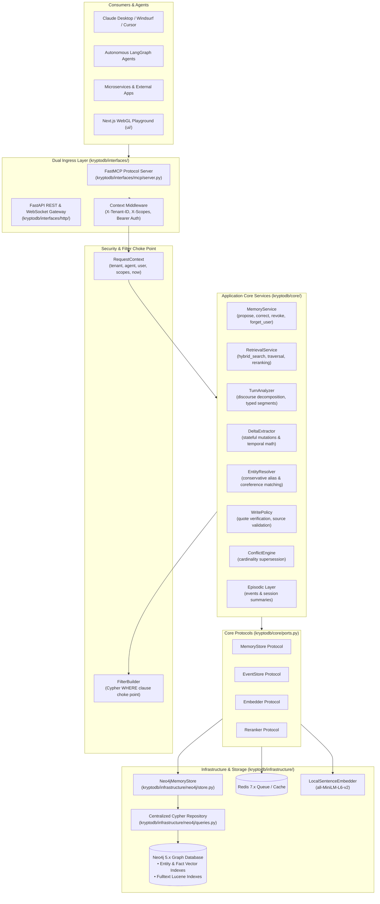
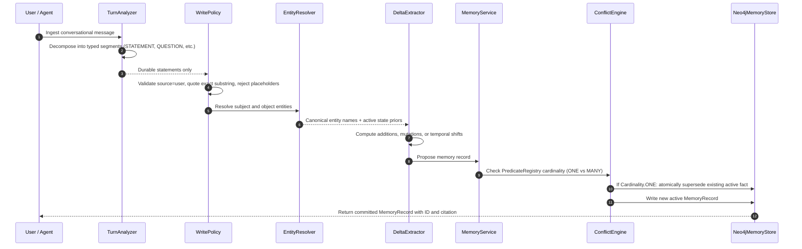
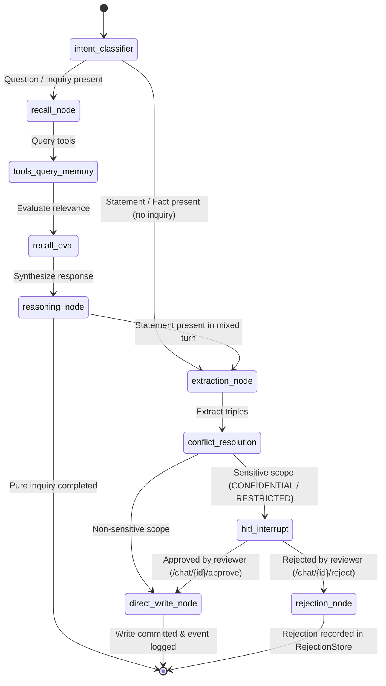

# KryptoDB: Complete System Architecture Specification

**Version:** 2.0.0  
**Classification:** Authoritative Technical Architecture Reference  
**Last Updated:** November 2026 (Phase 9 Complete)

---

## 1. Executive Overview

**KryptoDB** is an enterprise-grade, high-performance graph memory and GraphRAG substrate designed specifically for autonomous AI agents and multi-agent coordination. Built upon **Neo4j 5.x**, **Python 3.12+**, and **FastMCP/FastAPI**, KryptoDB bridges the gap between unstructured conversational state and persistent, verifiable knowledge graphs.

### Key Capabilities
- **Dual Ingress Layer**: Unified Model Context Protocol (FastMCP) tools for LLMs alongside high-throughput REST APIs for web/microservices.
- **Bi-Temporal Memory Lifecycle**: First-class tracking of real-world assertion validity (`valid_from` $\le$ now $<$ `valid_until`) and database transaction time (`created_at`).
- **Dynamic Schema Evolution**: Novel predicates are dynamically classified into cardinality rules (`Cardinality.ONE` vs `Cardinality.MANY`) at runtime.
- **Hybrid Reciprocal Rank Fusion (RRF)**: 384-dimensional cosine vector similarity search executed in parallel with Lucene BM25 fulltext search, fused with rank reciprocity ($k=60$) and semantic vector seed fallback.
- **Cycle-Safe Multi-Hop Traversal**: Bounded 1-to-2 hop associative Cypher graph traversal with explicit cycle suppression ($s \ne t \land s \ne \text{mid} \land \text{mid} \ne t$) and hub degree control ($\le 50$).
- **Scale-Harmonized Composite Reranking**: Normalized cross-encoder scoring, mean edge confidence, recency decay, and hop penalties.
- **Single Choke Point Multitenancy**: Strict enforcement of `tenant_id`, allowed scopes, active lifecycle status, and temporal validity through `RequestContext` and `FilterBuilder`.
- **Human-in-the-Loop (HITL) Gating**: LangGraph state machine interrupts on sensitive scopes (`CONFIDENTIAL`, `RESTRICTED`), backed by durable checkpointers and rejection auditing.
- **Real-Time WebGL Visualizer**: Next.js 16 / React 19 interface with 3D Earth Graph, Sigma.js ForceAtlas2 graph physics, and animated particle retrieval paths.

---

## 2. High-Level System Architecture

KryptoDB strictly adheres to **Hexagonal Architecture (Ports and Adapters)**, completely isolating domain logic from protocols, drivers, and external frameworks.



---

## 3. Subsystem Breakdown

### 3.1. Security & The Choke Point Architecture

Every request flowing into KryptoDB is parsed into an immutable, frozen [`RequestContext`](file:///mnt/DE94962594960067/Users/kandp/Documents/Work/Git_Files/AIAgent/kryptodb/core/context.py).

#### The RequestContext Dataclass
- `tenant_id`: Mandatory tenant boundary.
- `agent_id`: Identifier of the calling autonomous agent.
- `user_id`: Optional subject identifier for GDPR compliance and user data revocation.
- `session_id`: Conversation thread or session identifier.
- `active_scopes`: `FrozenSet[str]` defining allowed authorization scopes (e.g., `["default", "research", "PROJECT:kryptodb"]`).
- `now`: Strict timezone-aware UTC datetime anchoring all temporal evaluations.
- `is_system`: Bypass flag for privileged administrative indexing and maintenance.

#### The FilterBuilder Guarantee
[`FilterBuilder.build(context, alias="r")`](file:///mnt/DE94962594960067/Users/kandp/Documents/Work/Git_Files/AIAgent/kryptodb/core/filters.py) is the **single choke point** through which all Cypher read and search queries must pass. It returns a parameterized Cypher clause:
```cypher
r.tenant_id = $tenant_id
AND r.status = 'active'
AND r.valid_from <= $now
AND (r.valid_until IS NULL OR r.valid_until > $now)
AND r.scope IN $active_scopes
```
If an unauthorized caller provides no active scopes, `FilterBuilder` emits `"1 = 0"`, guaranteeing zero-leakage security at the database level.

---

### 3.2. Memory Management Subsystem

The memory subsystem transforms conversational turns into structured, cardinality-checked, verifiable knowledge graph triples.



#### Core Components
1. **[`TurnAnalyzer`](file:///mnt/DE94962594960067/Users/kandp/Documents/Work/Git_Files/AIAgent/kryptodb/core/memory/turn_analysis.py)**: Breaks complex user inputs into discourse segments (`STATEMENT`, `QUESTION`, `PREFERENCE`, `OPINION`, `COMMAND`, `CHITCHAT`). Questions are routed to retrieval queries and never marked as durable.
2. **[`WritePolicy`](file:///mnt/DE94962594960067/Users/kandp/Documents/Work/Git_Files/AIAgent/kryptodb/core/memory/write_policy.py)**: Enforces write integrity:
   - Verbatim quote substring verification against raw turn text.
   - Rejection of synthetic/placeholder entities (`Object`, `None`, `Unknown`, `value`).
   - Rejection of non-user source roles (preventing assistant hallucination feedback).
   - Rejection of speculative or hypothetical statements.
3. **[`DeltaExtractor`](file:///mnt/DE94962594960067/Users/kandp/Documents/Work/Git_Files/AIAgent/kryptodb/core/memory/delta_extractor.py)**: Takes active entity subgraph priors and conversation history to extract relative deltas (e.g., database upgrades, date shifts like *"push back 10 days"*, and pronoun coreferences).
4. **[`EntityResolver`](file:///mnt/DE94962594960067/Users/kandp/Documents/Work/Git_Files/AIAgent/kryptodb/core/memory/entity_resolution.py)**: Employs conservative identity resolution:
   - Auto-merges strictly on exact normalized name matching (`norm_name`).
   - Near matches ($\ge 0.70$ edit distance or prefix overlap) produce `POSSIBLE_SAME_AS` candidates and prompt clarifications (*"Did you mean Alice Chen?"*), never auto-merging.
5. **[`PredicateRegistry`](file:///mnt/DE94962594960067/Users/kandp/Documents/Work/Git_Files/AIAgent/kryptodb/core/memory/predicates.py)**: Manages semantic predicates and cardinality:
   - **`Cardinality.ONE` (Functional)**: e.g., `LIVES_IN`, `RUNS`, `LEAD_ARCHITECT`. New incoming facts supersede older active facts.
   - **`Cardinality.MANY` (Relational)**: e.g., `USES`, `DEPLOYED_ON`, `WORKS_FOR`. Multiple target entities coexist.
   - **Dynamic Schema Evolution**: Unseen predicates are auto-registered with `Cardinality.MANY` or inferred cardinality without schema crashes.
6. **[`ConflictEngine`](file:///mnt/DE94962594960067/Users/kandp/Documents/Work/Git_Files/AIAgent/kryptodb/core/memory/conflicts.py)**: Detects contradictions between existing active facts and new proposals, executing atomic supersession transitions.
7. **[`RejectionStore`](file:///mnt/DE94962594960067/Users/kandp/Documents/Work/Git_Files/AIAgent/kryptodb/core/memory/rejection_store.py)**: Tracks human reviewer rejections by hash `(agent_id, subject, predicate, object, scope)` to ensure declined proposals are never re-proposed.

---

### 3.3. Retrieval & GraphRAG Subsystem

The retrieval pipeline executes hybrid seed discovery, cycle-safe graph expansion, and multi-factor reranking in sub-50ms latency.

```mermaid
flowchart LR
    Query([Natural Language Query]) --> Parse[query.py: Deterministic Parser]
    Parse --> Hybrid[hybrid_search.py: Parallel Discovery]
    
    subgraph ParallelSearch ["Parallel Seed Search"]
        Hybrid --> Vector[Neo4j 384-dim Vector Search]
        Hybrid --> BM25[Neo4j Lucene Fulltext Search]
    end
    
    Vector --> RRF[rrf.py: Reciprocal Rank Fusion]
    BM25 --> RRF
    RRF -->|0 Seeds?| Fallback[Semantic Vector Seed Fallback]
    Fallback --> TopSeeds[Top-k Seed Entities]
    RRF -->|Seeds Found| TopSeeds
    
    TopSeeds --> Traverse[traversal.py: Cycle-Safe 1-2 Hop Traversal]
    Traverse --> CandidatePaths[Candidate Paths & Edges]
    CandidatePaths --> Rerank[ranking.py: Composite Cross-Encoder Scoring]
    Rerank --> Formatter[memory_context.py: Canonical Prompt Block]
    Formatter --> ContextOut([Attributed Memory Context + Citations])
```



#### Core Components
1. **[`QueryParser`](file:///mnt/DE94962594960067/Users/kandp/Documents/Work/Git_Files/AIAgent/kryptodb/core/retrieval/query.py)**: Deterministic, sub-millisecond query parsing extracting cleaned tokens, quoted terms, and temporal keywords (`"previously"`, `"history"`, `"before"`).
2. **[`HybridSearchEngine`](file:///mnt/DE94962594960067/Users/kandp/Documents/Work/Git_Files/AIAgent/kryptodb/core/retrieval/hybrid_search.py)**:
   - Queries `entity_embedding_idx` (dense cosine similarity).
   - Queries `entity_name_ft` (Lucene BM25).
   - Fuses rankings using [`reciprocal_rank_fusion`](file:///mnt/DE94962594960067/Users/kandp/Documents/Work/Git_Files/AIAgent/kryptodb/core/retrieval/rrf.py):
     $$\text{RRF}(d) = \sum_{m \in \{\text{vector}, \text{bm25}\}} \frac{1}{60 + \text{rank}_m(d)}$$
   - **Semantic Seed Fallback**: When queries have zero lexical overlap with entity names (e.g. associative questions), it falls back to cosine similarity over entity and relationship embeddings in the active scope.
3. **[`MultiHopTraverser`](file:///mnt/DE94962594960067/Users/kandp/Documents/Work/Git_Files/AIAgent/kryptodb/core/retrieval/traversal.py)**:
   - **1-Hop Expansion**: Discovers direct incoming and outgoing facts.
   - **2-Hop Associative Expansion**: Traverses through intermediate nodes with strict cycle suppression:
     $$s \ne t \land s \ne \text{mid} \land \text{mid} \ne t \land e_1 \ne e_2$$
   - **Hub Suppression**: Automatically prunes high-degree hub nodes ($\text{degree} > 50$) to avoid context dilution from dense distractor entities.
4. **[`PathReranker`](file:///mnt/DE94962594960067/Users/kandp/Documents/Work/Git_Files/AIAgent/kryptodb/core/retrieval/ranking.py)**: Combines multiple signals into a normalized score:
   $$\text{FinalScore}(P) = w_{\text{rel}} \cdot S_{\text{cross\_encoder}} + w_{\text{conf}} \cdot \overline{C}(P) + w_{\text{rec}} \cdot \text{Recency}(P) - \lambda_{\text{hop}} \cdot (\text{hops} - 1)$$
   Candidates scoring below `recall_relevance_cutoff` ($0.20$) are pruned.
5. **[`MemoryContextBuilder`](file:///mnt/DE94962594960067/Users/kandp/Documents/Work/Git_Files/AIAgent/kryptodb/core/retrieval/memory_context.py)**: Constructs structured `<retrieved_memories>` prompt injection blocks with standardized citations (`[Scope: ..., Edge: ...]`), preventing LLMs from confusing stored facts with immediate user statements.

---

### 3.4. Infrastructure & Data Topology

#### Neo4j Graph Model
- **`:Entity` Nodes**: Represent real-world entities (people, projects, databases, environments).
  - Properties: `id`, `name`, `tenant_id`, `embedding` (384-dim vector), `created_at`, `updated_at`.
- **`[:FACT]` Relationships**: Directed semantic facts connecting entities `(s:Entity)-[:FACT]->(o:Entity)`.
  - Properties: `id`, `predicate`, `description`, `confidence`, `trust_weight`, `scope`, `tenant_id`, `status` (`active` | `superseded` | `revoked`), `version`, `previous_version_id`, `superseded_by`, `valid_from`, `valid_until`, `created_at`, `source_agent_id`.
- **`:Event` Nodes**: Episodic conversation turns.
- **`:Episode` Nodes**: Consolidated multi-turn conversation summaries.

#### Native Indexes in Neo4j
- **Vector Indexes**:
  - `entity_embedding_idx`: 384-dim Cosine index on `(:Entity).embedding`
  - `fact_embedding_idx`: 384-dim Cosine index on `[:FACT].embedding`
- **Fulltext Lucene Indexes**:
  - `entity_name_ft`: Fulltext index on `(:Entity).name`
  - `fact_text_ft`: Fulltext index on `[:FACT].description`
- **Uniqueness & Lookup Constraints**:
  - `constraint_entity_name_tenant`: Unique `(name, tenant_id)` on `:Entity`
  - `constraint_fact_id_tenant`: Unique `(id, tenant_id)` on `[:FACT]`
  - `index_entity_tenant`: B-tree index on `(:Entity).tenant_id`
  - `index_fact_tenant_status`: Composite index on `[:FACT].(tenant_id, status)`

#### Centralized Queries Module
All Cypher interactions are centralized in [`kryptodb/infrastructure/neo4j/queries.py`](file:///mnt/DE94962594960067/Users/kandp/Documents/Work/Git_Files/AIAgent/kryptodb/infrastructure/neo4j/queries.py). Domain modules never execute inline or ad-hoc Cypher strings.

---

### 3.5. Agent Runtime & HITL State Machine

The agent runtime ([`kryptodb/agent_runtime/langgraph/graph.py`](file:///mnt/DE94962594960067/Users/kandp/Documents/Work/Git_Files/AIAgent/kryptodb/agent_runtime/langgraph/graph.py)) is implemented as a compiled LangGraph state machine.



#### Clean Output Channel Separation
To prevent output stack contamination (DEF-02):
- Human-facing agent reasoning is strictly preserved in `state.messages[-1]`.
- Internal memory write notifications (`"Fact committed: ..."`) are published exclusively to `state.system_events` and WebSocket event streams, never clobbering user conversation turns.

---

### 3.6. Next.js WebGL Frontend (`ui/`)

The frontend application provides real-time visualization and administrative governance:
- **Graph Explorer ([`GraphExplorer.tsx`](file:///mnt/DE94962594960067/Users/kandp/Documents/Work/Git_Files/AIAgent/ui/src/app/GraphExplorer.tsx))**: Sigma.js WebGL canvas utilizing ForceAtlas2 physics layout, color-coded by tenant and scope, with animated particle pulses along active multi-hop retrieval paths.
- **3D Earth Graph ([`earth-graph.tsx`](file:///mnt/DE94962594960067/Users/kandp/Documents/Work/Git_Files/AIAgent/ui/src/components/earth-graph.tsx))**: Global orbital graph view mapping multi-region cloud deployment nodes and cross-tenant bridges.
- **Interactive Chat Popup ([`ChatPopup.tsx`](file:///mnt/DE94962594960067/Users/kandp/Documents/Work/Git_Files/AIAgent/ui/src/app/ChatPopup.tsx))**: Real-time streaming chat interface with interactive memory cards:
  - Yellow cards for pending HITL writes with one-click Approve/Reject buttons.
  - Green badges showing committed `(Subject, Predicate, Object)` triples.
  - Interactive citation tags linking assistant answers directly to graph edges.
