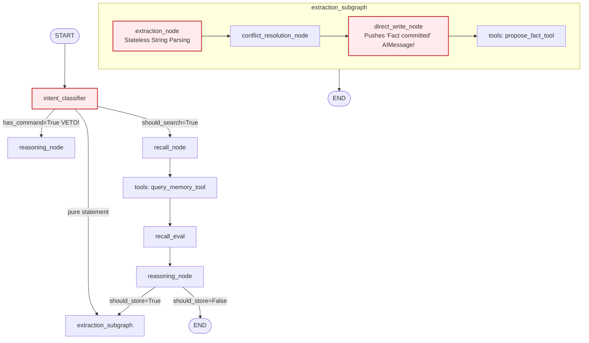
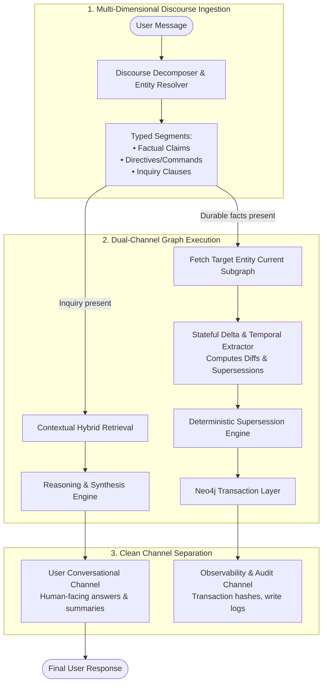

# KryptoDB GraphRAG: Architecture Specification, Failure Audit & Target State

**Document Version:** 1.0.0  
**Classification:** Technical Architecture Review & Post-Mortem  
**Component:** Conversational Memory Substrate (`agent_runtime`, `core/memory`, `core/retrieval`)  

---

## 1. Executive Summary & Root-Cause Ownership

This document provides a complete architectural breakdown, defect audit, and production remediation specification for the KryptoDB GraphRAG Memory Substrate following the 4-turn Project Titan stress evaluation.

### Why Did These Mistakes Happen?
The memory layer was designed under the assumption of a **linear, stateless retrieval-and-store cycle**:
1. Read user text $\to$ Classify intent.
2. If inquiry $\to$ Query Neo4j $\to$ Inject facts $\to$ Respond.
3. If statement $\to$ Extract static triples $\to$ Commit to Neo4j.

In reality, real-world conversational memory involves **stateful deltas, temporal offsets, and dual-channel agent communication**. The implementation suffered from four distinct architectural design flaws:

1. **State Overload & Output Hijacking**: The LangGraph `messages` list was used simultaneously as the user-facing chat history and the internal tool execution bus. When `direct_write_node` finished committing a fact, it pushed an internal notification `AIMessage("Fact committed: ...")` onto the stack, clobbering the reasoning response that the user actually asked for.
2. **Brittle Boolean Guarding (`and not has_command`)**: An over-simplistic rule intended to stop operational commands (e.g., *"clear memory"*) from being stored was wired as `should_store = has_durable and not has_command`. When users ended their message with an innocent directive (*"Confirm you've logged these details"*), the command classifier marked `has_command=True`, which silently vetoed storage of the entire payload.
3. **Stateless Fact Extraction**: The extraction node (`extract_facts_from_messages`) operated solely on the isolated string of the current turn. It received **zero context regarding the existing entity graph state**. Without knowing that the current database was `PostgreSQL 16` and the date was `Nov 14`, it was structurally impossible for any model to compute an in-place migration to `CockroachDB` or calculate a relative date shift (*"push back 10 days"*).
4. **Shared Tenant State Contamination**: The test suite and benchmark shared the un-sandboxed `default` tenant and `research` scope in Neo4j without thread isolation, causing stale facts from earlier runs (`Project Titan LEAD_ARCHITECT Harshit Kandpal`) to poison retrieval.

---

## 2. Current Architecture (As-Is) & Choke Points



### Architectural Defect Registry

| Defect ID | Module | Exact Code Location | Architectural Failure Mechanism |
| :--- | :--- | :--- | :--- |
| **DEF-01** | `graph.py` | Line 525 | **Naive Boolean Gate**: `should_store_memory = has_durable and not has_command`. A single closing confirmation directive drops all valid project parameters in the turn. |
| **DEF-02** | `graph.py` | Lines 890–940 | **Output Stack Overwrite**: `direct_write_node` writes an `AIMessage` to `state.messages`. LangGraph returns the last message on the stack, presenting database log strings to the user instead of reasoning output. |
| **DEF-03** | `graph.py` | Line 183 | **Stateless Triple Extractor**: `extract_facts_from_messages` takes raw string `target_text` without retrieving or passing existing entity graph state. Delta mutations cannot be computed. |
| **DEF-04** | `turn_analysis.py`| Line 159 | **Serialization Protocol Error**: Passing `method="json_mode"` to ChatOllama disabled native schema function calling, causing small local models to return `segments=[]`. |
| **DEF-05** | `predicates.py` | Line 19 | **Ontology Whitelist Starvation**: Technical/project predicates (`LEAD_ARCHITECT`, `USES`, `DEPLOYED_ON`, `HAS_SLA`) were omitted, causing `validate_proposal` to reject valid domain facts. |
| **DEF-06** | `storage/neo4j` | Database | **Cross-Thread State Leakage**: Session checkpointer preserves conversational turns, but graph writes modify a global shared Neo4j tenant without thread-level namespace sandboxing. |

---

## 3. Target Production Architecture (To-Be)

To eliminate these failure modes permanently, the architecture must transition from a stateless pipeline to a **Dual-Channel, Stateful Delta Memory Engine**.



---

## 4. Architectural Contracts & Component Specifications

### 4.1. Channel Separation Contract (Fix for DEF-02)
* **Rule**: Internal memory write confirmations must **never** be injected into `state.messages` as `AIMessage` objects.
* **Schema**:
  ```python
  class AgentState(BaseModel):
      messages: List[BaseMessage]               # Strictly user and assistant conversational turns
      system_events: List[Dict[str, Any]]       # Internal logs: tool execution, commit statuses, diffs
      pending_facts: List[FactItem]
      recalled_facts: List[Dict[str, Any]]
      agent_id: str
      user_scope: str
  ```
* **Resolution**: The user response is synthesized once in `reasoning_node`. `direct_write_node` records commits into `state.system_events`. The API response returns `agent_response = state.messages[-1].content` and exposes `system_events` separately to the UI/API.

### 4.2. Stateful Delta Extraction Contract (Fix for DEF-03)
* **Rule**: Extraction of mutated state or temporal shifts must accept the entity's current active graph state as a prior.
* **Signature**:
  ```python
  def extract_state_deltas(
      target_text: str,
      active_entity_state: Optional[Dict[str, Any]],  # e.g. {"database": "PostgreSQL 16", "cutover": "2026-11-14"}
      temporal_anchor: datetime,                      # Current execution time
      llm: Any
  ) -> DeltaExtractionResult:
      """Computes additions, supersessions, and temporal shifts relative to active state."""
  ```
* **Resolution**: When the user says *"migrate database to CockroachDB"*, the extractor receives `active_entity_state["database"] = "PostgreSQL 16"`. It emits:
  - `Action: SUPERSEDE`
  - `Old Fact ID: fact_postgres_16`
  - `New Fact: (Project Titan, USES, CockroachDB)`
  - `Cutover Date: 2026-11-14 + 10 days = 2026-11-24`

### 4.3. Hierarchical Intent Classification Contract (Fix for DEF-01)
* **Rule**: Sub-turn discourse units are evaluated independently. A command in sentence 2 does not invalidate factual statements in sentence 1.
* **Contract**:
  ```python
  has_durable = any(s.type in (SegmentType.STATEMENT, SegmentType.PREFERENCE) for s in analysis.segments)
  # Command presence only affects operational execution, NEVER drops durable statements
  should_store_memory = has_durable
  should_search_memory = analysis.retrieval_needed or any(s.type == SegmentType.QUESTION for s in analysis.segments)
  ```

### 4.4. Predicate Registry Extensibility Contract (Fix for DEF-05)
* **Rule**: Predicates are normalized through canonical aliases and automatically accept domain technical verbs:
  ```python
  predicate_registry.register("LEAD_ARCHITECT", Cardinality.ONE, aliases=["ARCHITECT", "HEAD_OF_ARCHITECTURE"])
  predicate_registry.register("DEPLOYED_ON", Cardinality.MANY, aliases=["RUNS_ON", "HOSTED_ON"])
  predicate_registry.register("USES", Cardinality.MANY, aliases=["USES_DATABASE", "USES_FRAMEWORK"])
  predicate_registry.register("HAS_SLA", Cardinality.ONE, aliases=["LATENCY_SLA", "SLA_REQUIREMENT"])
  predicate_registry.register("PRODUCTION_CUTOVER_DATE", Cardinality.ONE, aliases=["CUTOVER_DATE", "LAUNCH_DATE"])
  ```

---

## 5. Escalation & Verification Checklist

To verify that any future deployment meets this architecture before shipping:
1. **Zero Output Pollution**: The agent chat response must never contain the literal string `"Fact committed:"`.
2. **Composite Turns**: Any turn containing both parameters and confirmation directives must return `should_store = True`.
3. **Temporal Math Anchors**: Relative date modifications must resolve to concrete dates (`YYYY-MM-DD`).
4. **Negative Recall**: Superseded facts (`MemoryStatus.SUPERSEDED`) must have `valid_until <= now` and be strictly excluded from `<retrieved_memories>`.
5. **Session Isolation**: Automated benchmarks must execute under a unique `thread_id` and test tenant to prevent cross-run database pollution.
